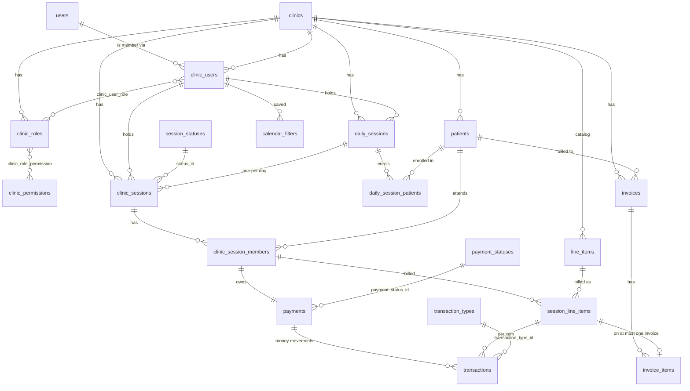
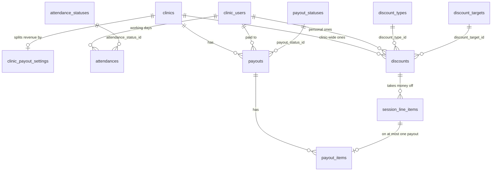
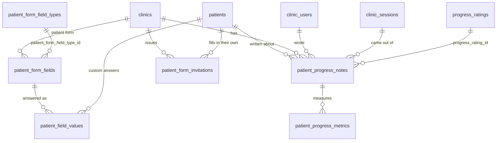

# Domain model

The app is a multi-clinic (SaaS) booking and billing system. Each **clinic**
is a separate tenant: its staff, patients, sessions, catalog, transactions and
invoices belong to it and are never visible to another clinic. **Super
admins** run the platform and sit outside every clinic.

## Entity diagram



Payroll hangs off the same billed item the patient is charged for, so it has
a diagram of its own rather than crowding the one above. A billed item can
be on at most one invoice and at most one payout: the same lock, used twice.



The patient form is the third cluster. `patients` keeps its nine columns as
the built-in fields; everything a clinic adds to its form is an answer.



## Tables

| Table                      | Model                   | Purpose                                                                      | Key columns / rules                                                                                                                                                                                                         |
| -------------------------- | ----------------------- | ---------------------------------------------------------------------------- | --------------------------------------------------------------------------------------------------------------------------------------------------------------------------------------------------------------------------- |
| `users`                    | `User`                  | Login accounts                                                               | `is_super_admin` (not mass-assignable)                                                                                                                                                                                      |
| `clinics`                  | `Clinic`                | The tenant                                                                   | `name`, `address`, `timezone`; soft-deleted                                                                                                                                                                                 |
| `clinic_users`             | `ClinicUser`            | A user's membership in a clinic                                              | unique (`clinic_id`, `user_id`); soft-deleted                                                                                                                                                                               |
| `clinic_roles`             | `ClinicRole`            | Roles per clinic                                                             | unique (`clinic_id`, `name`); `key` = `admin` / `worker` for the two built-in roles, `null` for custom ones                                                                                                                 |
| `clinic_permissions`       | `ClinicPermission`      | One row per grantable clinic API route                                       | `name` = route name, e.g. `clinic.patients.store`                                                                                                                                                                           |
| `clinic_user_role`         | —                       | Member ↔ role pivot                                                          | composite primary key                                                                                                                                                                                                       |
| `clinic_role_permission`   | —                       | Role ↔ permission pivot                                                      | composite primary key                                                                                                                                                                                                       |
| `patients`                 | `Patient`               | A clinic's patient list                                                      | names, `birth_date`, `sex` (`male`/`female`/`other`), contact details, `notes`; soft-deleted                                                                                                                                |
| `session_statuses`         | `SessionStatus` enum    | Lookup: PENDING, ONGOING, DONE, CANCELLED                                    | fixed IDs 1–4                                                                                                                                                                                                               |
| `clinic_sessions`          | `ClinicSession`         | A booked session, or one day of a daily session                              | `clinic_user_id` (the one member holding it), `name?`, `starts_at`, `ends_at` (UTC), `status_id`; `daily_session_id` + `occurs_on` (unique together) for a daily session's day                                              |
| `daily_sessions`           | `DailySession`          | A session that repeats on chosen weekdays inside a daily window              | `clinic_user_id` (**unique**: one per staff member), `name`, `line_item_id` + `unit_price` (billed per patient per day), `start_time`/`end_time` (clinic timezone), `weekdays` (ISO 1–7), `starts_on`, `ends_on?`           |
| `daily_session_patients`   | `DailySessionPatient`   | A patient enrolled in a daily session, with their regular plan               | unique (`daily_session_id`, `patient_id`); `line_item_id` + `unit_price` (service billed every day), usual slot `start_time` (clinic timezone) + `duration_minutes` (both null = no usual slot)                             |
| `payment_statuses`         | `PaymentStatus` enum    | Lookup: PENDING, DONE, REFUNDED                                              | fixed IDs 1–3                                                                                                                                                                                                               |
| `clinic_session_members`   | `ClinicSessionMember`   | A patient attending a session                                                | unique (`clinic_session_id`, `patient_id`); `starts_at`/`ends_at` = plotted slot on a daily session's day (null until plotted); `customised` = changed by hand for that day only                                            |
| `payments`                 | `Payment`               | What one patient owes for one session, and whether it is paid                | one per session member (`clinic_session_member_id` unique); `clinic_id`, `clinic_session_id`, `patient_id`, `payment_status_id`, `amount` (set when paid), `paid_at`, `refunded_at`                                         |
| `line_items`               | `LineItem`              | The clinic's billable catalog                                                | unique (`clinic_id`, `item_code`); `price` decimal(12,2); soft-deleted                                                                                                                                                      |
| `session_line_items`       | `SessionLineItem`       | A catalog item billed to one patient in one session                          | `clinic_session_member_id`, `line_item_id`, `quantity`, `unit_price` (copied from the catalog)                                                                                                                              |
| `transaction_types`        | `TransactionType` enum  | Lookup: INBOUND, REVERSED                                                    | fixed IDs 1–2                                                                                                                                                                                                               |
| `transactions`             | `Transaction`           | Append-only money ledger                                                     | `payment_id`, `session_line_item_id`, `transaction_type_id`, `amount`, `clinic_user_id` (who recorded it)                                                                                                                   |
| `invoices`                 | `Invoice`               | A statement for one patient                                                  | unique (`clinic_id`, `number`); `issued_at`, `notes`                                                                                                                                                                        |
| `invoice_items`            | `InvoiceItem`           | Session line items on an invoice                                             | `invoice_id`; `session_line_item_id` is **unique**                                                                                                                                                                          |
| `clinic_payout_settings`   | `ClinicPayoutSetting`   | How a clinic splits what it bills with its staff                             | one per clinic (`clinic_id` is unique), created on demand; `worker_share_percentage` (default 60), `include_pending_payments` (default true), `require_attendance` (default false)                                          |
| `attendances`              | `Attendance`            | One member's working day                                                     | unique (`clinic_user_id`, `work_date`); `work_date` is a date in the clinic's timezone; `attendance_status_id`, `checked_in_at`, `checked_out_at`, `notes`, `recorded_by_clinic_user_id`                                    |
| `discounts`                | `Discount`              | Money taken off a billed item                                                | `clinic_user_id` null = clinic-wide, set = that member's own; `name`, `discount_type_id`, `discount_target_id`, `value` decimal(12,2), `is_active`; soft-deleted                                                            |
| `payouts`                  | `Payout`                | What a clinic owes one member for a period                                   | unique (`clinic_id`, `number`, shown as `PAY-000001`); `period_start`/`period_end`, `payout_status_id`, `share_percentage`, `gross_amount`, `discount_total`, `worker_amount`, `clinic_amount`, `pending_amount`, `paid_at` |
| `payout_items`             | `PayoutItem`            | One billed item on a payout, with its split frozen                           | `payout_id`; `session_line_item_id` is **unique**; `share_percentage`, `gross_amount`, `discount_amount`, `worker_amount`, `clinic_amount`, `was_pending`, `settled_at`                                                     |
| `clinic_invitations`       | `ClinicInvitation`      | An email invited to join a clinic                                            | `email`, `clinic_role_id` (Clinic Worker), `token_hash` (SHA-256, unique), `invited_by_user_id`, `expires_at` (7 days), `accepted_at`, `accepted_by_user_id`, `revoked_at`                                                  |
| `patient_form_fields`      | `PatientFormField`      | One input on a clinic's patient form                                         | unique (`clinic_id`, `key`) **including removed rows**; `label`, `patient_form_field_type_id`, `options`, `validation`, `is_required`, `section`, `position`; `patient_column` set = built-in; soft-deleted                 |
| `patient_field_values`     | `PatientFieldValue`     | One patient's answer to one custom field                                     | unique (`patient_id`, `patient_form_field_id`); `value` is text (a MULTISELECT answer is a JSON array); the field is restricted, not cascaded, so archiving one keeps its answers                                           |
| `patient_progress_notes`   | `PatientProgressNote`   | How a patient is doing on one day                                            | `patient_id`, `clinic_user_id` (the author), `clinic_session_id?`, `recorded_on` (a date in the clinic's timezone), `progress_rating_id`, `summary`, `body`, `plan`; soft-deleted                                           |
| `patient_progress_metrics` | `PatientProgressMetric` | A measurement on a progress note                                             | unique (`patient_progress_note_id`, `name`); `value` decimal(10,2), `unit` (e.g. `/10`, `deg`, `kg`)                                                                                                                        |
| `patient_form_invitations` | `PatientFormInvitation` | A link letting a patient fill the form in themselves                         | `patient_id?` (set = update that record), `name`, `email`, `token_hash` (SHA-256, unique), `created_by_clinic_user_id`, `expires_at` (14 days), `submitted_at`, `revoked_at`                                                |
| `calendar_filters`         | `CalendarFilter`        | A schedule filter a member saved for themselves                              | `clinic_id`, `clinic_user_id`, `name`, `rules` (JSON: `match` + `conditions`)                                                                                                                                               |
| `activity_logs`            | `ActivityLog`           | Append-only audit trail of every change ([activity-log.md](activity-log.md)) | `clinic_id` (null = platform), `user_id`, `action`, subject, `changes`, `ip_address`; pruned after `ACTIVITY_RETENTION_DAYS`                                                                                                |

Two existing tables gained columns with these modules.
`clinic_users.payout_share_percentage` is one member's own cut of what they
bill, overriding the clinic default; null means "follow the clinic".
`session_line_items` gained `discount_id`, `discount_amount` and
`discount_target_id`: the rule that was applied, what it took off, and whose
side of the split paid for it. Those two amounts are snapshotted like
`unit_price`, so editing or archiving a discount afterwards never rewrites a
past bill or a past payout.

### Lookup tables and enums

`session_statuses`, `payment_statuses` and `transaction_types` are real tables
(foreign keys protect the data), seeded by their migration with **fixed IDs**.
Each has a PHP enum whose case values are those IDs (`App\Enums\SessionStatus`,
`PaymentStatus`, `TransactionType`), and the models cast the `*_id` columns
to the enum. The API reads and writes the upper-case codes (`"PENDING"`), never the IDs.
Never renumber a lookup row; add new rows in a new migration and a new enum case.

Payroll and the patient module added six more lookups, seeded the same way by
`2026_11_07_063557_create_payroll_lookup_tables` and
`2026_11_07_103724_create_patient_form_lookup_tables`.

| Table                      | Enum                   | Rows, with their fixed IDs                                                                            |
| -------------------------- | ---------------------- | ----------------------------------------------------------------------------------------------------- |
| `attendance_statuses`      | `AttendanceStatus`     | 1 PRESENT, 2 ABSENT, 3 LATE, 4 EXCUSED                                                                |
| `discount_types`           | `DiscountType`         | 1 PERCENTAGE, 2 FIXED                                                                                 |
| `discount_targets`         | `DiscountTarget`       | 1 CLINIC, 2 WORKER                                                                                    |
| `payout_statuses`          | `PayoutStatus`         | 1 DRAFT, 2 PAID, 3 CANCELLED                                                                          |
| `patient_form_field_types` | `PatientFormFieldType` | 1 TEXT, 2 TEXTAREA, 3 NUMBER, 4 DATE, 5 SELECT, 6 MULTISELECT, 7 CHECKBOX, 8 RADIO, 9 EMAIL, 10 PHONE |
| `progress_ratings`         | `ProgressRating`       | 1 BASELINE, 2 IMPROVED, 3 UNCHANGED, 4 DECLINED, 5 RESOLVED                                           |

These enums carry the rules that go with their rows, so the rule lives in one
place: `AttendanceStatus::countsAsWorked()`, `DiscountType::deductionFrom()`,
`PayoutStatus::canTransitionTo()`, `PatientFormFieldType::canSafelyBecome()`
and `ProgressRating::direction()`.

## Changes from the original specification

The first draft of the tables had these inconsistencies. This is how each was resolved.

| #   | Original                                                     | Problem                                                                                                                                            | Resolution                                                                                                                                                                                                                                                                                                                                   |
| --- | ------------------------------------------------------------ | -------------------------------------------------------------------------------------------------------------------------------------------------- | -------------------------------------------------------------------------------------------------------------------------------------------------------------------------------------------------------------------------------------------------------------------------------------------------------------------------------------------- |
| 1   | `session` table / model                                      | Laravel already uses `sessions` for login sessions (`SESSION_DRIVER=database`), and a `Session` model would be confused with the `Session` helper. | Renamed to `ClinicSession` / `clinic_sessions` and `clinic_session_members`. URLs still say `/sessions`.                                                                                                                                                                                                                                     |
| 2   | `start`, `end`                                               | `END` is a MySQL keyword and the names ignore Laravel's `*_at` convention. Times without a timezone are ambiguous across clinics.                  | `starts_at`, `ends_at`, stored in UTC; `clinics.timezone` added.                                                                                                                                                                                                                                                                             |
| 3   | `invoice_items (id, session_line_item_id)`                   | No `invoice_id`, so an item could not be linked to its invoice. Nothing stopped an item being invoiced twice.                                      | Added `invoice_id`; `session_line_item_id` is unique.                                                                                                                                                                                                                                                                                        |
| 4   | Price only on `line_items`                                   | Changing a catalog price would rewrite every past bill, payment and invoice.                                                                       | `session_line_items` stores `quantity` and `unit_price`; `transactions` stores `amount`.                                                                                                                                                                                                                                                     |
| 5   | `session_line_items (session_id, patient_id)`                | The pair is not checked, so a patient who is not in the session could be billed.                                                                   | Replaced with `clinic_session_member_id`.                                                                                                                                                                                                                                                                                                    |
| 6   | Payment status on the session member, money on the line item | It was unclear how one status change becomes transactions.                                                                                         | Marking DONE writes one INBOUND transaction per billed item; REFUNDED writes one REVERSED per item. Allowed changes: PENDING → DONE → REFUNDED.                                                                                                                                                                                              |
| 7   | `transactions.status` (INBOUND/REVERSED)                     | It describes the direction of money, not a status, and there was no amount or audit trail.                                                         | `transaction_type_id` + `amount` + `clinic_user_id`. Transactions are never updated or deleted.                                                                                                                                                                                                                                              |
| 8   | `invoices (id, clinic_id, patient_id)`                       | No invoice number or date.                                                                                                                         | `number` (counts up per clinic, shown as `INV-000001`), `issued_at`, `notes`.                                                                                                                                                                                                                                                                |
| 9   | `clinic_roles` had no clinic                                 | Clinics add their own roles, and the built-in roles must be told apart from custom ones.                                                           | `clinic_id` + `key` (`admin` / `worker` / `null`). Both built-ins are created with every clinic.                                                                                                                                                                                                                                             |
| 10  | "Admin default role cannot be changed" + editable roles      | A member allowed to edit roles could grant themselves everything.                                                                                  | The Admin role implicitly holds every permission and cannot be edited or deleted. Role and member management are Admin-only and never grantable. Worker cannot be deleted or renamed, but its permissions can change. A clinic always keeps at least one Admin.                                                                              |
| 11  | Endpoint-based permissions                                   | Needs a source of truth and must never include super admin endpoints.                                                                              | Generated from the routes guarded by the `clinic.permission` middleware (see [api.md](api.md#permissions)). Internal routes are a separate group with separate middleware.                                                                                                                                                                   |
| 12  | "Basic patient details"                                      | Not defined.                                                                                                                                       | First/middle/last name, birth date, sex, email, phone, address, notes.                                                                                                                                                                                                                                                                       |
| 13  | Hard deletes                                                 | Deleting patients, catalog items, members or clinics would break billing history.                                                                  | Soft deletes for `clinics`, `clinic_users`, `patients`, `line_items`. Sessions with billed items cannot be deleted (cancel instead).                                                                                                                                                                                                         |
| 14  | Session status from a table, others as plain values          | Inconsistent.                                                                                                                                      | All three are lookup tables (chosen during planning).                                                                                                                                                                                                                                                                                        |
| 15  | One user, many clinics?                                      | Not specified.                                                                                                                                     | A user can belong to many clinics; the clinic comes from the URL. Super admins cannot be clinic members.                                                                                                                                                                                                                                     |
| 16  | Payment status on `clinic_session_members`                   | Prepaying future daily-session days needs a payment before anything is billed, and two places for the status (member and a payments list) drift.   | `payments` is the single source of payment state (one row per session member, migrated from `payment_status_id`, which was dropped). Transactions point at their payment and stay one per billed item; days of a daily session always bill its service, so every payment has items. See [Payments and the ledger](#payments-and-the-ledger). |
| 17  | A discount simply lowers the price                           | With a revenue split, somebody has to pay for the discount, and one bigger than the side it comes off would push that side negative.               | `discounts.discount_target_id` (CLINIC or WORKER) says whose cut pays. `RevenueSplit` takes the discount out of that side first and spills what is left onto the other, so neither side can go negative and `worker + clinic` always equals the net the patient owes. The target is snapshotted on the billed item.                          |
| 18  | Staff pay as another `transaction_type`                      | Transactions are one per billed item per patient payment and are never updated. Staff pay has a period, a share, a draft stage and a cancel.       | Payouts got their own ledger (`payouts` + `payout_items`), with the same "at most one" lock `invoice_items` uses. `transactions` stays the record of what patients paid, so the two questions — what did we take, what do we owe — never corrupt each other.                                                                                 |
| 19  | Every patient detail moved to key/value                      | The schedule, invoices and patient search read `first_name`, `last_name`, `email` and `phone` as columns; key/value makes each one a join.         | The nine original columns stay, as **built-in** fields pointed at by `patient_form_fields.patient_column`. Only what a clinic adds goes to `patient_field_values`. Built-in fields can be relabelled, reordered and regrouped, but never removed or retyped.                                                                                 |
| 20  | Field keys unique per clinic among live fields               | A removed field still owns its answers. A new field taking its key would attach them to a different question.                                      | The unique index on (`clinic_id`, `key`) spans removed rows, so a removed field keeps its key until it is restored. Adding a field with an archived key is refused with a message pointing at the Removed tab, instead of "already in use" about something the admin cannot see.                                                             |

## Business rules

**Sessions**

- Held by exactly one member of the same clinic (any role). A member cannot
  hold two overlapping sessions, or a session over a patient plotted into one
  of their daily sessions; cancelled sessions do not count.
- Status changes: PENDING → ONGOING or CANCELLED; ONGOING → DONE or CANCELLED.
  DONE and CANCELLED are final. A session someone has paid for cannot be
  cancelled until the payment is refunded.
- Name, time, assigned member and patients can change only while the session is
  PENDING or ONGOING.
- Deleting is only possible while no patient has billed items.

**Session members (patients in a session)**

- A patient can be in a session once, and must belong to the same clinic.
- Adding a patient creates their payment (PENDING).
- A patient can be removed while their payment is PENDING; their unpaid
  billed items and payment are removed with them. Paid or refunded patients
  stay (the transactions refer to them).

**Daily sessions**

- A staff member holds at most one daily session (`daily_sessions.clinic_user_id`
  is unique). It is kept up to date instead of creating another: updated when
  the plan changes, paused or stopped with `ends_on`, resumed by clearing it.
- Updating with the full list of patients syncs them in one transaction: new
  patients are enrolled, changed plans apply to upcoming days (except days
  changed by hand) and patients left out leave upcoming days. If one of them
  cannot leave (they prepaid an upcoming day), nothing is saved.
- A daily session repeats on its `weekdays` from `starts_on` until `ends_on`
  (open-ended if null), between `start_time` and `end_time` in the clinic's
  timezone. Each day is a `clinic_sessions` row (`daily_session_id`,
  `occurs_on`), created 14 days ahead (`ScheduleDailySessionDays::DAYS_AHEAD`)
  when the daily session is created and by the hourly
  `clinic:schedule-daily-sessions` command, or on demand when a later day is
  prepaid.
- Every enrolled patient has a **regular plan**: the service billed every day
  (`line_item_id`, `unit_price`; the daily session's service is only the
  default) and an optional **usual slot** (`start_time` + `duration_minutes`,
  clinic time). Usual slots must be inside the daily hours and must not
  overlap each other.
- Every enrolled patient is on every day that has not ended, billed their
  service (copied onto the day's `session_line_items`), with a PENDING
  payment. When a day is created they are put into their usual slot if the
  staff member is free then; otherwise they wait unplotted ("to plot"), and
  earlier usual slots win.
- A day's window does not block its holder; only patients plotted into it do.
  A plotted slot (`clinic_session_members.starts_at/ends_at`) must be inside
  the window and must not overlap the holder's regular sessions or other
  plotted patients. The day's API response lists the remaining `vacancies`
  and the `busy` time taken by other sessions.
- **Changing one day is for that day only.** Moving, unplotting or changing
  the service of a patient on a day marks them `customised` on that day; the
  next day follows the regular plan again. `reset` puts the patient back on
  the plan for that day. A day's service can only change while it is unpaid.
- **Days run on their own.** A day is ONGOING from the start of its date in
  the clinic's timezone and DONE once its hours end
  (`AdvanceDailySessionDays`, run every minute by
  `clinic:advance-daily-session-days`; new days are created with the right
  status). Cancelling is the only manual status change, for today or a
  future day; starting or finishing a day by hand is refused (422). Once a day
  is DONE its patients can no longer be plotted or changed.
- **The current day can be rearranged while it runs** (last-minute
  changes): patients can be moved, unplotted, plotted into time already past
  (to record what happened), given another service while unpaid, or added for
  that day only (a walk-in, billed the default service). Once a day has
  started, regular-plan changes no longer touch it.
- **Changing the regular plan** updates every upcoming day (not started,
  PENDING) except days changed by hand for that patient; the service only on
  unpaid days. Past days never change.
- Enrolling a patient adds them to every day that has not ended. Removing one
  takes them off those days (with the unpaid bills) and keeps past days,
  including unpaid ones (which stay past due). Refused while the patient has
  prepaid an upcoming day.
- Editing a daily session re-plans days that have not started: new name,
  holder and window; patients go back into their usual slots (days changed
  by hand keep their slot while it still fits); days no longer on the
  schedule are removed (refused if someone prepaid one). A new default
  service only applies to patients enrolled afterwards. Past days never
  change. Changing the clinic's timezone does not move existing days; edit
  the daily session to re-plan them.
- A day cannot be edited or deleted as a regular session; cancel it instead.
  Deleting a daily session is only possible while nobody has paid for any
  of its days; otherwise set `ends_on`.

**Invitations**

- A super admin (internal tool) or a Clinic Admin (Staff page, `clinic.admin`
  routes, never a grantable permission) invites an email to a clinic; the person joins as Clinic
  Worker and an admin can change their role afterwards. One pending
  invitation per email and clinic; members and super admins cannot be
  invited.
- Status is derived: accepted, revoked, expired (after 7 days) or pending.
  Resending issues a new token (the old link stops working) and a new expiry.
- Accepting with an existing account joins the clinic straight away; without
  one, the person chooses a name and password first. A user can belong to
  many clinics, so the clinic is added next to their others.

**Billing**

- Items are billed from the clinic's own catalog (archived items cannot be
  billed). `unit_price` defaults to the catalog price and can be overridden.
- Billed items can be added, edited or removed only while the patient's payment
  is PENDING and the item is not on an invoice. Cancelled sessions cannot get
  new items.
- A cancelled session cannot be paid. A payment can be refunded, unless any of
  its items is on an invoice (remove them from the invoice first).

**Payments**

- Statuses: PENDING → DONE → REFUNDED (`PaymentStatus::canTransitionTo()`).
- "Past due" is not stored: a PENDING payment whose session has ended and was
  not cancelled. "Outstanding" is PENDING on a session that was not cancelled.
- Prepaying records DONE on chosen upcoming days of a daily session for an
  enrolled patient (up to 90 days ahead), creating days that are not
  scheduled yet. All or nothing: a cancelled or already-paid day fails the
  whole request.

**Invoices**

- One patient per invoice. Every item must be billed to that patient in that
  clinic, be **paid** (its payment DONE) and not be on another invoice.
- Deleting an invoice frees its items to be invoiced again.
- Invoices do not track payment themselves; payment lives on `payments` and
  in `transactions`.

**Payouts and attendance**

- A clinic splits what it bills between itself and the member who held the
  session. `clinic_payout_settings.worker_share_percentage` is the
  clinic-wide cut (60% until an admin changes it);
  `clinic_users.payout_share_percentage` overrides it for one member, and
  null means they follow the clinic.

```
gross       = quantity × unit price
net         = gross − discount          what the patient owes
worker base = gross × share%
clinic base = gross − worker base
```

- The discount comes out of the side it targets (`discount_target_id`:
  CLINIC or WORKER). If it is bigger than that side, the remainder spills
  onto the other one, so neither side can go negative and `worker + clinic`
  always equals `net`. All of this lives in `App\Support\RevenueSplit`.
- An item earns a member money when **all six** of these hold: the session
  is theirs (`clinic_sessions.clinic_user_id`); it started inside the period
  (dates in the clinic's timezone); the session is not cancelled and has
  ended; the payment was not refunded; the item is not already on a payout;
  and either the clinic does not `require_attendance`, or the member was
  PRESENT or LATE that day. ABSENT and EXCUSED do not count as worked
  (`AttendanceStatus::countsAsWorked()`).
- `include_pending_payments` is on by default, so a member is paid for work
  the patient has not settled yet. Turn it off and pending items simply wait
  for the next payout.
- Previewing and generating run the same `CalculatePayout`, and generating
  runs it again inside its own transaction, so what the page showed is what
  gets saved. The share, the totals and every line are snapshotted on the
  payout and its items: changing the configuration afterwards never moves a
  payout that already exists. Payouts count up per clinic and are shown as
  `PAY-000001`.
- Statuses: DRAFT → PAID or CANCELLED; PAID → CANCELLED. CANCELLED is final
  (`PayoutStatus::canTransitionTo()`). **Cancelling deletes the payout's
  items**, which releases them to be paid out again, exactly as deleting an
  invoice frees its items; the totals stay on the payout as a record of what
  was cancelled. A draft can be deleted outright; a payout that has been
  paid is cancelled instead.
- An item is on **at most one payout** (`payout_items.session_line_item_id`
  is unique). While it is, the billed item cannot be edited or removed; the
  error names the payout to cancel first.
- Attendance is one row per member per day (unique on `clinic_user_id` and
  `work_date`). The member and the date are fixed once the row exists —
  change the status, times or notes instead. Only a Clinic Admin may record
  or change a day for someone else; everyone else writes their own.
- A discount is either clinic-wide (`clinic_user_id` null, Clinic Admins
  only) or personal to one member, and a personal one is invisible to
  everybody else, including admins. Its scope never changes. Archiving a
  discount leaves past bills alone, because what it took off was copied onto
  the item when it was billed.

**The patient form**

- Every clinic is created with the same nine **built-in** fields
  (`CreateDefaultPatientForm`): first name, middle name, last name, date of
  birth, sex, email, phone, address and notes.
- A built-in field carries a `patient_column` and reads and writes that real
  column on `patients`. That is the whole reason it can be relabelled,
  reordered, regrouped and given help text, but **never removed, rekeyed or
  retyped**: the schedule, invoices and patient search read those columns.
  `first_name` and `last_name` cannot even be made optional, because the
  database will not accept them as null
  (`PatientFormField::ALWAYS_REQUIRED_COLUMNS`).
- Everything a clinic adds is a **custom** field, and its answers live in
  `patient_field_values`, one row per patient per field. A MULTISELECT
  answer is stored as a JSON array, everything else as text.
- Removing a custom field is a **soft delete**. The question disappears from
  the form, the answers stay (the foreign key restricts deletion rather than
  cascading) and they come back if the field is restored.
- Three changes need `confirm: true` once people have answered: removing a
  field, renaming its key, and changing its type. A type change the existing
  answers could not survive is refused outright, naming up to three of them.
  Widening anything to text is always safe; narrowing is not
  (`PatientFormFieldType::canSafelyBecome()`).
- The unique index on (`clinic_id`, `key`) **spans removed rows**, so a
  removed field keeps hold of its key until it is restored. Adding a field
  with an archived key is refused with a message pointing at the Removed
  tab, rather than "already in use" about something the admin cannot see.
- There is one definition of the form. `PatientFormSchema` turns it into
  validation rules, and the staff dialog, the public intake link, the API
  and the printable PDF all come from it, so they cannot drift apart. On
  create, required fields are required; on update everything is `sometimes`,
  so a partial update stays partial.
- An **intake link** lets one patient fill the form in with no account. Only
  a SHA-256 hash of the token is stored, the link works once, and it expires
  after 14 days (`PatientFormInvitation::VALID_FOR_DAYS`). With a
  `patient_id` it updates that record and shows what it already says, so the
  patient corrects rather than retypes; without one it takes on a new
  patient. Resending issues a new token, and the old link stops working.

**Progress notes**

- A note is about one patient on one day (`recorded_on`, a date in the
  clinic's timezone), optionally tied to the session it came out of. It
  carries a `summary`, an optional `body` and an optional `plan` — what to
  do before the next visit.
- `progress_rating_id` rates the change since the note before it: BASELINE,
  IMPROVED, UNCHANGED, DECLINED or RESOLVED. `ProgressRating::direction()`
  reduces that to 1 (better), 0 (flat) or −1 (worse), which is what the
  trend above a patient's notes is drawn from; BASELINE and UNCHANGED are
  both 0.
- A note can carry up to twenty **metrics**: a free-text `name` ("Pain",
  "Knee flexion"), a decimal `value` and an optional `unit` ("/10", "deg",
  "kg"), unique by name within the note. Sending `metrics` replaces the
  whole set; leaving it out of an update leaves them alone.
- The author may edit or remove their own note, and a Clinic Admin may edit
  or remove any. Removing is a soft delete, so a clinical judgement is never
  destroyed.
- The clinical detail stays out of the audit trail: `body` and `plan` are
  redacted, so the log records that a note changed, not what the patient
  told their therapist.

## Payments and the ledger

```
session patient ──1:1── payment (PENDING → DONE → REFUNDED)
       │                    │
 billed items ───────── transactions: one per item per movement
                          INBOUND on DONE, REVERSED on REFUNDED
```

- `UpdatePaymentStatus` is the only writer of transactions. It locks the
  payment row, checks the transition, writes one transaction per billed item
  (each with `payment_id` and `session_line_item_id`), stores the paid total on
  `payments.amount` and logs `payment.recorded` / `payment.refunded`.
- For any payment, the sum of its INBOUND transactions equals `amount`, and a
  refund reverses exactly the same items (they are locked once paid).
- Why not a payment-level ledger or a patient credit balance? Both were
  considered. One transaction per billed item keeps the per-service money trail
  and the invoice rules simple. Days of daily sessions always bill their
  service, so a prepayment always has items to attach transactions to. A
  credit balance (deposit, then draw down per day) would let a cancelled day
  keep the money as credit instead of a refund; it can be added later as a
  separate `credits` ledger without changing these tables.
- Existing data was migrated: one payment per existing session member with its
  old status; `amount`, `paid_at` and `refunded_at` were taken from its
  transactions, which now point at the payment.

What a billed item is worth is now **net of its discount**.
`SessionLineItem::amount()` is `grossAmount()` (quantity × unit price) less
`discount_amount`, and that is the figure payments, transactions and invoices
are all built from, so the patient is charged the discounted price
everywhere. `grossAmount()` is only the pre-discount number the revenue split
is worked out from.

An item can be **paid out to staff while its payment is still PENDING**, and
that is the receivable: the clinic has advanced a member their share and has
not collected the money yet. `payout_items.was_pending` records that it
happened, and `settled_at` is stamped by `UpdatePaymentStatus` when the
patient finally pays. A refund clears it again, re-opening the receivable,
because the clinic is owed that money once more. Nothing else writes those
two columns, so the outstanding total is always the sum of `worker_amount`
where `was_pending` is true and `settled_at` is null.
